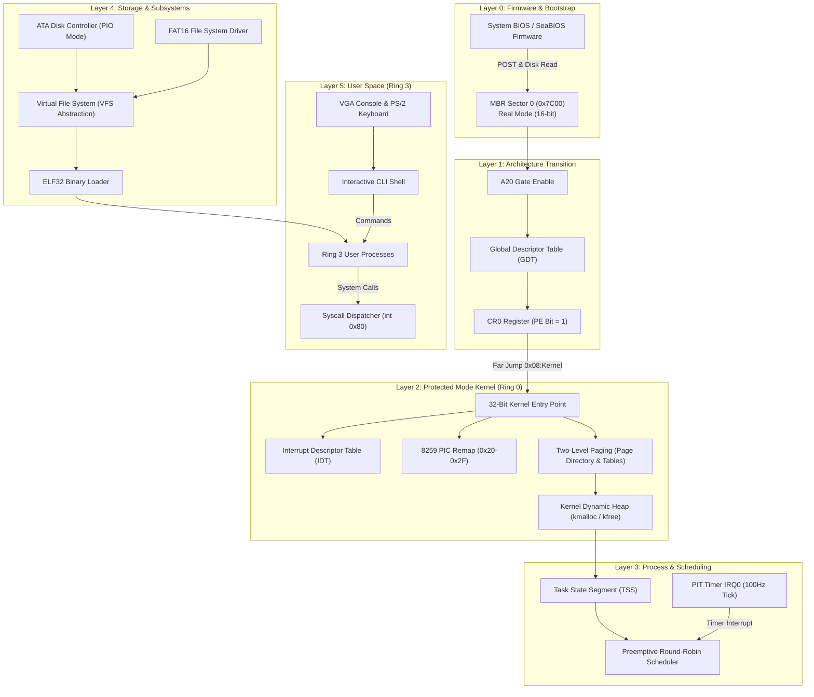
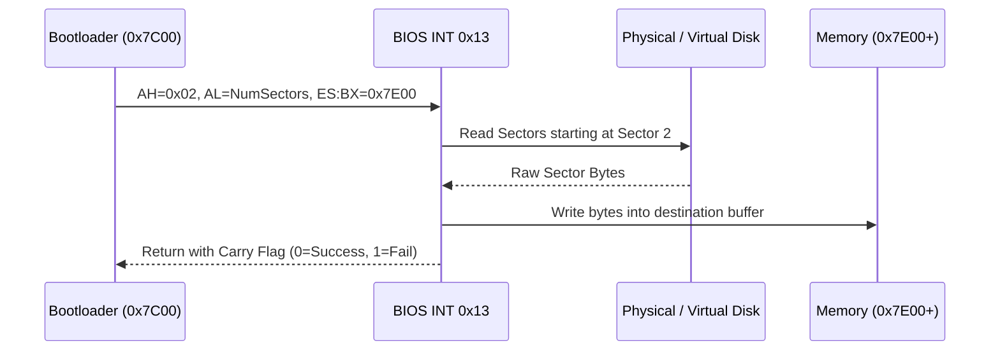
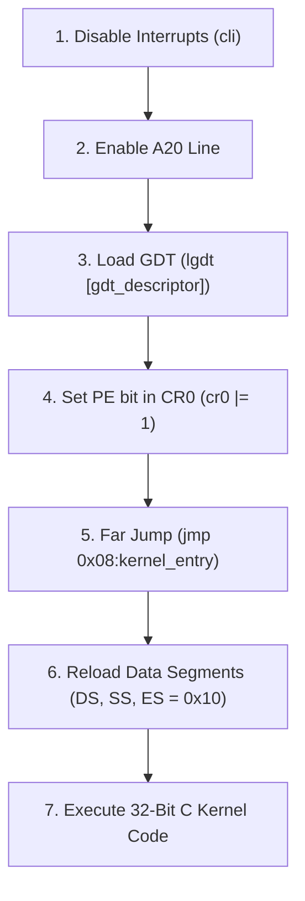

# SatnaOS: Deep Technical Architecture & Engineering Guide

> A comprehensive, first-principles systems engineering reference and knowledge base for **SatnaOS** — a 32-bit multitasking x86 operating system and kernel.

---

## Table of Contents
1. [Architectural Overview & System Knowledge Graph](#1-architectural-overview--system-knowledge-graph)
2. [x86 Execution Model & Memory Topology](#2-x86-execution-model--memory-topology)
3. [Toolchain Deep Dive: From Source to Silicon](#3-toolchain-deep-dive-from-source-to-silicon)
4. [Phase 1: Toolchain & Freestanding Build Architecture](#4-phase-1-toolchain--freestanding-build-architecture)
5. [Phase 2: Bare-Metal Real-Mode Bootloader (16-bit)](#5-phase-2-bare-metal-real-mode-bootloader-16-bit)
   - [The BIOS Bootstrapping Sequence](#the-bios-bootstrapping-sequence)
   - [Why Address 0x7C00?](#why-address-0x7c00)
   - [Line-by-Line Dissection of `boot.asm`](#line-by-line-dissection-of-bootasm)
   - [Machine Opcode Decoding & Hex Dump Anatomy](#machine-opcode-decoding--hex-dump-anatomy)
   - [BIOS Interrupt Subsystems (`INT 0x10`)](#bios-interrupt-subsystems-int-0x10)
   - [String Traversal Mechanics (`lodsb`)](#string-traversal-mechanics-lodsb)
   - [Sector Padding & Magic Signature `0xAA55`](#sector-padding--magic-signature-0xaa55)
6. [Phase 3 Blueprint: Disk I/O & BIOS Services](#6-phase-3-blueprint-disk-io--bios-services)
7. [Phase 4 Blueprint: 32-Bit Protected Mode & Memory Segmentation](#7-phase-4-blueprint-32-bit-protected-mode--memory-segmentation)
8. [Phase 5–8 Roadmap: Memory, Multitasking & VFS](#8-phase-58-roadmap-memory-multitasking--vfs)
9. [Portfolio Integration Showcase](#9-portfolio-integration-showcase)

---

## 1. Architectural Overview & System Knowledge Graph

SatnaOS is designed as a layered, modular operating system. The system starts execution in the lowest-privilege, historical 16-bit Real Mode environment provided by the BIOS and progressively constructs hardware descriptors, memory tables, and CPU modes to transition into a preemptive 32-bit kernel.



---

## 2. x86 Execution Model & Memory Topology

### Real Mode (16-Bit) Addressing
When the processor powers on, it runs in **Real Address Mode**. In this mode:
- All general-purpose registers (`AX`, `BX`, `CX`, `DX`, `SI`, `DI`, `BP`, `SP`) are 16 bits wide.
- Memory addressing is limited to **1 Megabyte ($2^{20}$ bytes)** spanning `0x00000000` to `0x000FFFFF`.
- Addresses are formed through **segmentation**:
$$\text{Physical Address} = (\text{Segment} \times 16) + \text{Offset} = (\text{Segment} \ll 4) + \text{Offset}$$

### Real Mode Low-Memory Map
Below is the standard memory map for the first megabyte of RAM during boot:

| Memory Range | Typical Usage |
| :--- | :--- |
| `0x00000 - 0x003FF` | **Interrupt Vector Table (IVT)**: 256 4-byte far pointers to BIOS/hardware handlers. |
| `0x00400 - 0x004FF` | **BIOS Data Area (BDA)**: Hardware state, keyboard buffers, timer counters. |
| `0x00500 - 0x07BFF` | **Conventional Free Memory**: Usable scratchpad space for bootloader code and stacks. |
| `0x07C00 - 0x07DFF` | **Boot Sector (512 Bytes)**: Where the BIOS loads our MBR. |
| `0x07E00 - 0x7FFFF` | **Conventional Free Memory (~480 KB)**: Ideal target area for loading early kernel sectors. |
| `0x80000 - 0x9FFFF` | **Extended BIOS Data Area (EBDA)**. |
| `0xA0000 - 0xBFFFF` | **Video Display Memory**: `0xB8000` is the standard VGA color text buffer (80x25 characters). |
| `0xC0000 - 0xFFFFF` | **BIOS ROM & Motherboard Memory-Mapped Hardware**. |

---

## 3. Toolchain Deep Dive: From Source to Silicon

Building an operating system kernel requires a **freestanding environment**. In standard user-mode development, code links against the C runtime library (`libc`), which relies on POSIX system calls provided by the host OS kernel. In bare-metal development:
1. **No Host Dependencies:** There are no host header files, no host dynamic linkers (`ld.so`), and no default entry points (`main`).
2. **Exact Instruction Control:** Every byte in the output binary must directly map to hardware instructions or precise data structures.

### Tool Roles & Functionality

#### NASM (Netwide Assembler)
- Converts assembly mnemonics into raw x86 machine opcodes.
- Supported output formats:
  - `-f bin`: Pure flat binary (no headers, no symbol tables). Used for the MBR and raw kernel blobs.
  - `-f elf32`: 32-bit ELF object files, which contain relocation symbols suitable for the linker `i686-elf-ld`.

#### QEMU (Quick Emulator)
- A complete hardware emulator that simulates an entire x86 motherboard, CPU, memory, and devices in software.
- Uses **TCG (Tiny Code Generator)** to translate guest x86 instructions on the fly into host machine instructions.
- Includes **SeaBIOS**, an open-source BIOS implementation that executes the Power-On Self-Test (POST) and boots our disk image.

#### GDB (GNU Debugger)
- Attaches to QEMU via its built-in GDB server (`-s -S` flags).
- Enables step-by-step instruction execution (`si`), CPU register dumps (`info registers`), and memory inspection (`x/16xb 0x7c00`) directly on the virtual CPU.

---

## 4. Phase 1: Toolchain & Freestanding Build Architecture

### Why a Dedicated Cross-Compiler is Mandatory
A common pitfall in OS development is compiling with the host Linux `gcc` using flags like `-m32`. While this generates 32-bit instructions, host `gcc` assumes the target is a Linux environment:
- It may emit references to the Global Offset Table (GOT) or Procedure Linkage Table (PLT).
- It injects glibc initialization symbols (`_start`, `__libc_start_main`).
- It can emit SIMD or red-zone optimizations incompatible with early kernel interrupt states.

A cross-compiler built for **`i686-elf`** targets a pure, freestanding 32-bit ELF environment with **zero host assumptions**.

---

## 5. Phase 2: Bare-Metal Real-Mode Bootloader (16-bit)

### The BIOS Bootstrapping Sequence
1. **Power-On Reset:** The CPU initializes with `CS = 0xF000` and `IP = 0xFFF0` (physical address `0xFFFF0`), which points directly into the BIOS ROM.
2. **POST (Power-On Self Test):** The BIOS tests system RAM, discovers connected drives (Floppy, IDE, SATA, USB), and initializes the display.
3. **Boot Device Selection:** The BIOS scans available storage devices in prioritized boot order.
4. **Sector Inspection:** It reads Cylinder 0, Head 0, Sector 1 (the first 512-byte sector, or LBA 0) into physical memory at address **`0x0000:0x7C00`**.
5. **Signature Validation:** It inspects the final two bytes (offsets 510 and 511). If they equal `0x55` and `0xAA`, the BIOS executes a far jump to `0x0000:0x7C00`, transferring total control to our bootloader.

### Why Address 0x7C00?
In 1981, the engineers designing the IBM PC 5150 decided to load the boot sector at `0x7C00`. At the time, minimum system RAM was 32 Kilobytes (`32 KB = 32,768 bytes = 0x8000`). 
By placing the 512-byte (`0x200`) bootloader at `0x7C00` (`0x8000 - 0x200 - 0x200`), they left maximum contiguous low memory (`0x0500` to `0x7BFF`, roughly 30 KB) free for the bootloader or OS to load its second-stage binaries, while leaving room above for a downward-growing stack.

---

### Line-by-Line Dissection of `boot.asm`

Below is the annotated source code for the Stage 1 MBR bootloader in [`SatnaOS/boot.asm`](file:///home/praveen/Documents/vs/kernel/SatnaOS/boot.asm):

```nasm
ORG 0x7c00
BITS 16 

start:
    mov si, message
    call print
    jmp $

print:
    mov bx, 0
.loop:
    lodsb
    cmp al, 0
    je .done
    call print_char
    jmp .loop
.done:
    ret

print_char:
    mov ah, 0eh
    int 0x10
    ret    

message db 'Hello, World!', 0

times 510 - ($ - $$) db 0
dw 0xaa55
```

#### Detailed Line Analysis

1. **`ORG 0x7c00`**
   - **Assembler Directive:** Informs NASM that the program will be loaded at memory offset `0x7C00`.
   - **Why It Matters:** All internal memory references (such as `mov si, message`) compute the absolute address of `message` as:
     $$\text{Address of } message = 0x7C00 + \text{offset of } message \text{ within the binary}$$
     Without `ORG 0x7c00`, NASM would assume the file starts at `0x0000`, causing `SI` to point to the Interrupt Vector Table instead of our string!

2. **`BITS 16`**
   - **Assembler Directive:** Instructs NASM to emit 16-bit real-mode machine opcodes. Register names like `AX`, `SI`, and `BX` refer to 16-bit registers.

3. **`start:` & `mov si, message`**
   - Loads the 16-bit physical pointer of the `message` label into the Source Index (`SI`) register.

4. **`call print`**
   - Pushes the current instruction pointer (`IP`) onto the stack and branches execution to the `print` label.

5. **`jmp $`**
   - In NASM syntax, `$` represents the current instruction address.
   - `jmp $` generates an unconditional relative jump back to its own address. This creates an intentional infinite loop, preventing the CPU from executing arbitrary uninitialized bytes following the program.

6. **`print:` & `mov bx, 0`**
   - Sets the base register `BX` to `0`. For the BIOS video interrupt (`INT 0x10`), `BH` represents the active video display page number (page 0 is the default screen).

7. **`lodsb` (Load String Byte)**
   - A specialized x86 string instruction. It performs two hardware operations in a single opcode:
     1. Reads the byte located at the segmented address `[DS:SI]` into register `AL`.
     2. Increments `SI` by 1 (assuming the Direction Flag `DF` is clear).

8. **`cmp al, 0` & `je .done`**
   - Evaluates whether the byte in `AL` is `0` (the null terminator). If zero, the Zero Flag (`ZF`) is set, and `je` (Jump if Equal) branches to `.done`, completing the string output.

9. **`print_char:` & `mov ah, 0eh` & `int 0x10`**
   - Invokes the **BIOS Video Services**. Function `0x0E` represents **Teletype Output**.
   - The BIOS prints the ASCII character present in `AL` at the current cursor location and automatically advances the hardware cursor.

10. **`ret`**
    - Pops the return address from the stack back into `IP`, returning control to the caller.

11. **`message db 'Hello, World!', 0`**
    - `db` (Define Byte) places the ASCII bytes directly into the binary followed by a terminating `0` byte.

12. **`times 510 - ($ - $$) db 0`**
    - `$$` denotes the start of the current section (`0x7C00`).
    - `$` denotes the current assembly position.
    - `($ - $$)` equals the total number of bytes written so far.
    - `times 510 - ($ - $$) db 0` fills every remaining byte up to byte 510 with `0x00`.

13. **`dw 0xaa55`**
    - `dw` (Define Word) writes a 2-byte word. Due to x86 little-endian architecture, the bytes are emitted onto the disk in the order:
      - Byte 511: `0x55`
      - Byte 512: `0xAA`

---

### Machine Opcode Decoding & Hex Dump Anatomy

When we inspect the assembled `boot.bin` using a hexadecimal analyzer (`hexdump -C boot.bin`), we observe the exact machine translation:

```
00000000  be 1b 7c e8 02 00 eb fe  bb 00 00 ac 3c 00 74 05  |..|.........<.t.|
00000010  e8 03 00 eb f6 c3 b4 0e  cd 10 c3 48 65 6c 6c 6f  |...........Hello|
00000020  2c 20 57 6f 72 6c 64 21  00 00 00 00 00 00 00 00  |, World!........|
00000030  00 00 00 00 00 00 00 00  00 00 00 00 00 00 00 00  |................|
*
000001f0  00 00 00 00 00 00 00 00  00 00 00 00 00 00 55 aa  |..............U.|
00000200
```

#### Detailed Byte-to-Instruction Mapping

| Byte Offset | Hex Bytes | Assembly Mnemonic | Architectural Explanation |
| :---: | :--- | :--- | :--- |
| `0x0000` | `BE 1B 7C` | `mov si, 0x7c1b` | Opcode `BE` is 16-bit immediate move to `SI`. `1B 7C` is little-endian for `0x7C1B`, the exact memory address where the string begins. |
| `0x0003` | `E8 02 00` | `call print` | Opcode `E8` is a 16-bit relative call. `02 00` indicates a forward jump of +2 bytes. |
| `0x0006` | `EB FE` | `jmp $` | Opcode `EB` is a short jump. `FE` is signed two's complement for `-2`, jumping back exactly to the `EB` instruction itself. |
| `0x0008` | `BB 00 00` | `mov bx, 0x0000` | Opcode `BB` moves immediate 16-bit value `0x0000` to `BX`. |
| `0x000B` | `AC` | `lodsb` | 1-byte opcode loading `[DS:SI]` into `AL` and incrementing `SI`. |
| `0x000C` | `3C 00` | `cmp al, 0` | Opcode `3C` compares `AL` against immediate byte `0x00`. |
| `0x000E` | `74 05` | `je .done` | Opcode `74` is Jump if Equal (Zero Flag set). Jumps +5 bytes ahead to `ret`. |
| `0x0010` | `E8 03 00` | `call print_char` | Relative call jumping +3 bytes ahead. |
| `0x0013` | `EB F6` | `jmp .loop` | Short jump with operand `F6` (signed `-10`), branching backward to `lodsb`. |
| `0x0015` | `C3` | `ret` | Opcode `C3` pops return address from stack to `IP`. |
| `0x0016` | `B4 0E` | `mov ah, 0x0e` | Opcode `B4` moves immediate byte `0x0E` into `AH` (BIOS Teletype code). |
| `0x0018` | `CD 10` | `int 0x10` | Opcode `CD` triggers software interrupt vector `0x10` (BIOS Video Service). |
| `0x001A` | `C3` | `ret` | Returns to `print` loop caller. |
| `0x001B` | `48 65 6C 6C 6F... 00` | `'Hello, World!', 0` | Raw ASCII character byte sequence followed by null byte `0x00`. |
| `0x0029 - 0x01FD` | `00 00 00...` | Sector Zero Padding | 469 bytes of zeroes padding the sector to 510 bytes. |
| `0x01FE` | `55 AA` | Boot Signature | Magic boot bytes identifying a valid MBR to the BIOS. |

---

## 6. Phase 3 Blueprint: Disk I/O & BIOS Services

The boot sector is strictly limited to 512 bytes. A full operating system kernel with memory management, drivers, and filesystems requires tens or hundreds of kilobytes. Therefore, the primary job of the boot sector is to act as a **bootloader**: it must load the remaining sectors from the disk into RAM.

### BIOS Disk Interrupt `INT 0x13`, Function `0x02`
In Real Mode, the BIOS provides disk services through software interrupt `0x13`:

- **Input Parameters:**
  - `AH = 0x02`: Function code for "Read Sectors from Drive".
  - `AL = Number of sectors to read` (e.g., `1` to `128`).
  - `CH = Cylinder number` (low 8 bits of cylinder).
  - `CL = Sector number` (bits 0–5 = sector number 1–63; bits 6–7 = high 2 bits of cylinder).
  - `DH = Head number` (0 to 255).
  - `DL = Drive number` (e.g., `0x80` for First Hard Disk, `0x00` for Floppy).
  - `ES:BX = Destination memory buffer` (segment:offset where data will be stored in RAM).

- **Output / Return:**
  - **Carry Flag (`CF`):** If set (`CF = 1`), an error occurred; `AH` contains the error code. If clear (`CF = 0`), the read succeeded.



---

## 7. Phase 4 Blueprint: 32-Bit Protected Mode & Memory Segmentation

### What Changes in Protected Mode?
1. **Full 32-bit Registers:** Access to `EAX`, `EBX`, `ECX`, `EDX`, `ESP`, `EBP`, `ESI`, `EDI`.
2. **4 Gigabyte Linear Address Space:** Flat addressing without needing segment multiplication ($2^{32} = 4\text{ GB}$).
3. **Hardware Privilege Rings:** Ring 0 (Kernel Supervisor) vs. Ring 3 (User Applications).
4. **Memory Protection:** Page fault and General Protection Fault (`#GP`) exceptions prevent rogue applications from crashing the system.

### The Global Descriptor Table (GDT)
In Protected Mode, segment registers (`CS`, `DS`, `SS`, `ES`) no longer hold segment base addresses. Instead, they hold **Segment Selectors**—offsets into an array of 8-byte descriptors called the **Global Descriptor Table (GDT)**.

```
GDT Structure:
+-------------------------------------------------------------+
| Entry 0: Null Descriptor (Required by Intel CPU)           |
+-------------------------------------------------------------+
| Entry 1: Kernel Code Segment Descriptor (Base=0, Limit=4GB) |
+-------------------------------------------------------------+
| Entry 2: Kernel Data Segment Descriptor (Base=0, Limit=4GB) |
+-------------------------------------------------------------+
```

### The Transition Sequence


---

## 8. Phase 5–8 Roadmap: Memory, Multitasking & VFS

- **Phase 5: Interrupts, Paging & Dynamic Heap**
  - Remap the 8259 Programmable Interrupt Controller (PIC) to avoid colliding with CPU exception vectors (`0x00`–`0x1F`).
  - Configure two-level 4KB paging: Page Directory (1024 entries) $\to$ Page Tables (1024 entries each) $\to$ 4KB physical pages.
  - Implement a kernel heap allocator (`kmalloc` / `kfree`) using block headers and boundary tags.

- **Phase 6: Multitasking & Preemptive Scheduling**
  - Construct Process Control Blocks (PCB) tracking saved registers, kernel stack pointers, and page directory pointers.
  - Implement the Task State Segment (TSS) for handling privilege ring switches.
  - Configure the Programmable Interval Timer (PIT) at 100 Hz to trigger context switches.

- **Phase 7: Virtual File System & ELF Execution**
  - Abstract storage operations behind a uniform VFS interface (`open`, `read`, `write`, `close`).
  - Build a FAT16 filesystem driver capable of traversing directories and parsing clusters.
  - Parse 32-bit ELF binaries, load program headers into virtual memory, and execute user programs in Ring 3.

- **Phase 8: Hardware Drivers & Command Shell**
  - Implement a PS/2 keyboard controller interrupt handler with an asynchronous ring buffer.
  - Develop a VGA text mode driver supporting terminal scrolling and cursor repositioning.
  - Ship an interactive CLI shell supporting basic utility commands (`help`, `ls`, `cat`, `run`, `clear`).

---

## 9. Portfolio Integration Showcase

This section provides ready-to-use summaries and technical bullet points designed for integration into a personal engineering portfolio website (GitHub Pages / Vercel).

### Project Summary (Short Blurb)
> **SatnaOS:** A 32-bit multitasking x86 operating system and kernel written in C and assembly from bare metal. Features custom MBR bootloader, two-level 4KB paging, preemptive round-robin task scheduler, FAT16 filesystem driver, and user-space ELF32 execution.

### Key Engineering Competencies Demonstrated
- **Low-Level Systems Architecture:** Real Mode, Protected Mode, A20 gate, GDT, IDT, PIC remapping, and CPU privilege rings.
- **Memory Management:** Two-level paging virtual memory manager, page fault handling, and dynamic kernel heap allocation algorithms.
- **Concurrency & Scheduling:** Preemptive timer-based context switching, Process Control Blocks (PCB), and hardware Task State Segments (TSS).
- **Filesystems & Storage:** ATA disk driver in PIO mode, FAT16 BPB and cluster parsing, and an extensible Virtual File System (VFS) abstraction.
- **Binary Formats:** ELF32 header parsing, program segment mapping, and transition to unprivileged user mode (Ring 3).

