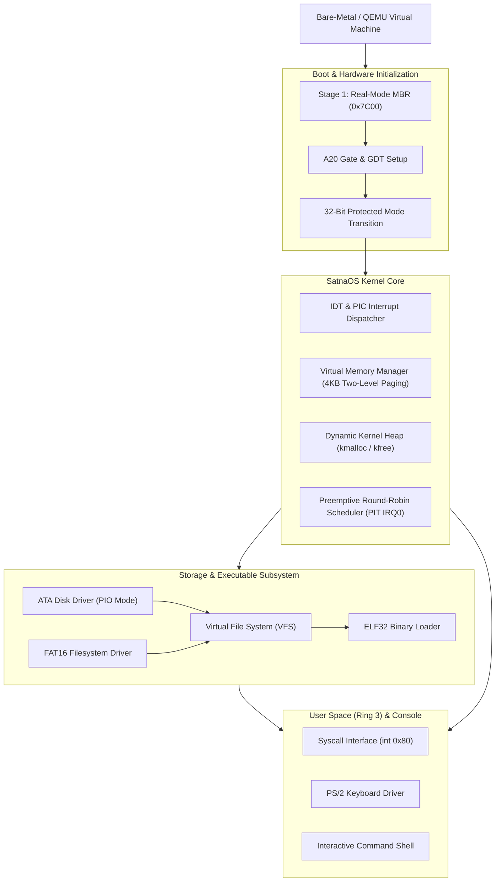

# SatnaOS: 32-Bit Multitasking x86 Operating System & Kernel

-blue.svg)


**SatnaOS** is a modular, 32-bit multitasking operating system kernel engineered from first principles for the x86 architecture. The project begins at the bare-metal Master Boot Record (MBR) and systematically constructs a complete, self-contained kernel architecture featuring protected mode execution, paging-based virtual memory, dynamic heap management, preemptive task scheduling, a Virtual File System (VFS) with FAT16 support, user-mode isolation (Ring 3), and an interactive shell.

---

## Architecture Overview



---

## Engineering Phases & Roadmap

System development is structured into 8 sequential engineering phases. Real-time checklist and progress logs are tracked in [GOALS.md](GOALS.md), and in-depth architectural breakdowns are documented in [KERNEL_GUIDE.md](KERNEL_GUIDE.md).

| Phase | Milestone | Description | Status |
| :---: | :--- | :--- | :---: |
| **01** | **Toolchain & Environment** | Bare-metal cross-compilation toolchain (`i686-elf`), NASM, QEMU, GDB. | Verified |
| **02** | **Real-Mode Bootloader** | 512-byte MBR boot sector at `0x7C00`, BIOS interrupts, text output. | **Completed** |
| **03** | **Disk I/O & Real-Mode Interrupts** | Multi-sector loading via BIOS `INT 0x13`, disk error handling routines. | In Progress |
| **04** | **32-Bit Protected Mode Switch** | A20 Gate activation, Global Descriptor Table (GDT), CR0 PE bit, far jump. | Upcoming |
| **05** | **Interrupts, Paging & Memory Heap** | IDT configuration, 8259 PIC remap, two-level 4KB paging, `kmalloc`/`kfree`. | Upcoming |
| **06** | **Multitasking & Process Management** | TSS setup, context switching, Process Control Blocks, PIT scheduler. | Upcoming |
| **07** | **VFS, FAT16 & ELF Executable Loading**| ATA disk driver, FAT16 filesystem implementation, ELF32 loader, Ring 3. | Upcoming |
| **08** | **Hardware Drivers & Interactive Shell**| PS/2 keyboard IRQ handler, VGA text console, interactive CLI shell. | Upcoming |

---

## Repository Structure

```
.
├── AGENTS.md            # Universal developer and AI agent engineering guidelines
├── GOALS.md             # Operational phase tracker, file inventory, and changelog
├── KERNEL_GUIDE.md      # Deep technical knowledge base & architectural reference
├── README.md            # Public repository overview and build documentation
├── roadmap.html         # Interactive web-based roadmap GUI dashboard
└── SatnaOS/
    ├── boot.asm         # 16-bit real-mode MBR boot sector (origin 0x7c00)
    └── boot.bin         # Assembled 512-byte raw bootable disk image
```

---

## Quickstart & Build Instructions

### Prerequisites
Ensure the following tools are installed on your host system:
- **NASM** (Netwide Assembler)
- **QEMU** (`qemu-system-i386` or `qemu-system-x86_64`)

```bash
# On Debian/Ubuntu systems
sudo apt update
sudo apt install -y nasm qemu-system-x86
```

### Assembling & Running the Boot Sector

1. **Assemble the boot sector to a flat binary:**
   ```bash
   cd SatnaOS
   nasm -f bin boot.asm -o boot.bin
   ```

2. **Verify image size (must be exactly 512 bytes):**
   ```bash
   ls -la boot.bin
   ```

3. **Launch in QEMU:**
   ```bash
   qemu-system-i386 -drive format=raw,file=boot.bin
   ```

---

## Deep Documentation

- **Knowledge Base:** For detailed instruction encodings, hardware register mechanics, memory maps, and technical walkthroughs, see [KERNEL_GUIDE.md](KERNEL_GUIDE.md).
- **Milestone Tracker:** For real-time task statuses and hardware inventory, see [GOALS.md](GOALS.md).
- **Interactive Roadmap:** Open [roadmap.html](roadmap.html) in any modern browser for an interactive milestone dashboard.

---

## License

This project is licensed under the MIT License. See [LICENSE](LICENSE) for details.
