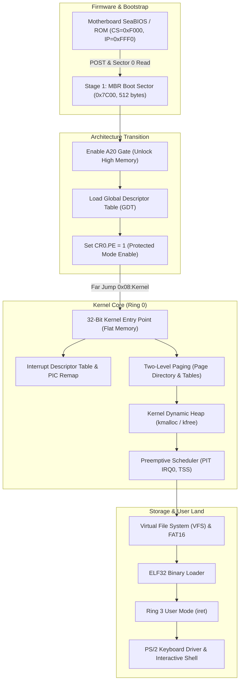

# SatnaOS: Deep Kernel Architecture & Systems Knowledge Base

> **A First-Principles Guide for Systems Programmers & C++ Engineers**  
> Document Version: 1.1 (Phase 2 Complete / Phase 3 Transition)

---

## Navigation & Topic Index
- [1. Systems Architecture & Execution Model](#1-systems-architecture--execution-model) *(Line ~20)*
- [2. Memory Topology: The First Megabyte](#2-memory-topology-the-first-megabyte) *(Line ~65)*
- [3. C++ Mental Models for Bare-Metal Systems](#3-c-mental-models-for-bare-metal-systems) *(Line ~110)*
- [4. Phase 1: Toolchain Architecture](#4-phase-1-toolchain-architecture) *(Line ~160)*
- [5. Phase 2: Bare-Metal Real-Mode Bootloader (16-Bit)](#5-phase-2-bare-metal-real-mode-bootloader-16-bit) *(Line ~205)*
  - [The Boot Sequence: From Reset Vector to 0x7C00](#the-boot-sequence-from-reset-vector-to-0x7c00)
  - [Dissection of `SatnaOS/boot.asm`](#dissection-of-satnaosbootasm)
  - [Opcode Hex Dump & Instruction Decoding Table](#opcode-hex-dump--instruction-decoding-table)
- [6. Phase 3 Blueprint: Multi-Sector Disk Loading via BIOS INT 0x13](#6-phase-3-blueprint-multi-sector-disk-loading-via-bios-int-0x13) *(Line ~310)*
- [7. Phase 4 Blueprint: 32-Bit Protected Mode Transition](#7-phase-4-blueprint-32-bit-protected-mode-transition) *(Line ~360)*

---

## 1. Systems Architecture & Execution Model

SatnaOS is a modular 32-bit x86 kernel. Developing an OS from scratch requires understanding that modern CPUs do not start in high-level 64-bit or 32-bit protected states. Instead, Intel processors power on in **16-bit Real Address Mode** to maintain 100% backward compatibility with the original 1978 Intel 8086 processor.



---

## 2. Memory Topology: The First Megabyte

In 16-bit Real Mode, the CPU possesses a 20-bit address bus, capable of accessing exactly **$2^{20} = 1,048,576\text{ bytes } (1\text{ MB})$** of physical RAM.

Memory addresses are represented as **`Segment:Offset`**:
$$\text{Physical Address} = (\text{Segment} \times 16) + \text{Offset} = (\text{Segment} \ll 4) + \text{Offset}$$

### Real Mode Physical Memory Map

| Physical Address Range | Size | Allocation / Description |
| :--- | :--- | :--- |
| `0x00000 - 0x003FF` | 1,024 B | **Interrupt Vector Table (IVT):** 256 4-byte entries (segment:offset far pointers) for BIOS and hardware interrupts. |
| `0x00400 - 0x004FF` | 256 B | **BIOS Data Area (BDA):** Hardware states, serial/parallel ports, timer tick counts. |
| `0x00500 - 0x07BFF` | ~30 KB | **Conventional Free Memory:** Usable RAM for bootloader scratchpad and stacks. |
| **`0x07C00 - 0x07DFF`** | **512 B** | **Boot Sector (MBR):** Target memory where BIOS loads our `boot.bin`. |
| `0x07E00 - 0x7FFFF` | ~480 KB | **Conventional Free Memory:** Primary staging area where we will load our subsequent kernel sectors from disk. |
| `0x80000 - 0x9FFFF` | 128 KB | **Extended BIOS Data Area (EBDA)**. |
| `0xA0000 - 0xBFFFF` | 128 KB | **Video Display Memory:** `0xB8000` is the memory-mapped I/O buffer for VGA text mode (80 columns $\times$ 25 rows). |
| `0xC0000 - 0xFFFFF` | 256 KB | **Motherboard ROM & BIOS Firmware**. |

---

## 3. C++ Mental Models for Bare-Metal Systems

As an intermediate C++ developer, many concepts in systems programming directly mirror abstractions you already use:

| C++ Paradigm | Low-Level Systems Equivalent | Conceptual Explanation |
| :--- | :--- | :--- |
| `reinterpret_cast<uint8_t*>(addr)` | **Direct Memory Pointer** | In OS dev, physical memory is a contiguous byte array. Pointing to `0xB8000` is literally creating a raw pointer to video display hardware. |
| `std::vector` / `new` / `delete` | **Kernel Dynamic Heap** | In userspace C++, the runtime requests memory from the OS via `brk`/`mmap`. In kernel space, **you are the OS**—you must write the allocator (`kmalloc`/`kfree`) from raw page blocks. |
| `virtual` Method Tables (`vptr`/`vtbl`) | **Interrupt Vector Table (IVT / IDT)** | A vtable is an array of function pointers indexed by method ID. The CPU's IDT is an array of interrupt handlers indexed by interrupt number (`0x10`, `0x80`). |
| Exception Handling (`try` / `catch`) | **CPU Traps & Faults** | A division by zero doesn't throw `std::runtime_error`; it triggers CPU interrupt `0x00` (Divide Error). If unhandled, it triggers a Triple Fault and reboots. |
| Thread Context / Call Stack | **Saved Registers & ESP** | A thread switch is simply pausing one instruction stream, saving registers (`EAX`, `EBX`, `ESP`) into memory (PCB), loading another thread's saved registers, and returning. |
| `no-stdlib` / Freestanding | **Zero Runtime Overhead** | We compile with `-ffreestanding -fno-builtin -nostdlib`. There is no `<iostream>`, `<memory>`, or `<string>`. Every utility must be constructed from first principles. |

---

## 4. Phase 1: Toolchain Architecture

### The Freestanding Compilation Pipeline
1. **NASM (Netwide Assembler):**
   - Assembles assembly files into flat binaries (`-f bin`) for MBR code, or 32-bit ELF object files (`-f elf32`) for protected mode.
2. **QEMU System Emulator:**
   - Provides a sandboxed virtual PC with SeaBIOS, virtual 8259 interrupt controllers, IDE hard disk emulation, and serial/VGA display.
   - Command syntax: `qemu-system-i386 -drive format=raw,file=boot.bin` explicitly treats `boot.bin` as a raw sector disk.
3. **Dedicated Cross-Compiler (`i686-elf-gcc`):**
   - Essential for compiling kernel C files without host OS library leakage. Targets pure 32-bit ELF specifications.

---

## 5. Phase 2: Bare-Metal Real-Mode Bootloader (16-Bit)

### The Boot Sequence: From Reset Vector to 0x7C00
1. **CPU Reset:** Upon power delivery, the CPU registers are set to known states:
   $$\text{CS} = 0xF000, \quad \text{IP} = 0xFFF0 \implies \text{Physical Address} = 0xFFFF0$$
2. **BIOS POST:** The motherboard ROM checks system memory and enumerates bootable media.
3. **MBR Loading:** BIOS reads the first 512-byte sector (Cylinder 0, Head 0, Sector 1) of the boot disk into RAM at physical address **`0x0000:0x7C00`**.
4. **Signature Check:** BIOS validates that bytes 510–511 equal `0x55` and `0xAA`.
5. **Execution Hand-off:** BIOS performs a far jump to `0x0000:0x7C00`.

---

### Dissection of `SatnaOS/boot.asm`

Below is the verified implementation in [`SatnaOS/boot.asm`](file:///home/praveen/Documents/vs/kernel/SatnaOS/boot.asm):

```nasm
ORG 0x7c00        ; Informs assembler all label offsets are relative to 0x7C00
BITS 16           ; Directs NASM to emit 16-bit real-mode machine instructions

start:
    mov si, message   ; Load address of string into Source Index (SI)
    call print        ; Invoke string printing subroutine
    jmp $             ; Infinite loop (halt execution safely)

print:
    mov bx, 0         ; BH=0 (video display page 0)
.loop:
    lodsb              ; AL = [DS:SI], SI++
    cmp al, 0          ; Check for null-terminator
    je .done           ; If AL == 0, return
    call print_char    ; Render character on screen
    jmp .loop          ; Iterate to next character
.done:
    ret

print_char:
    mov ah, 0eh        ; BIOS teletype output function code
    int 0x10           ; Video services software interrupt
    ret    

message db 'Hello, World!', 0

times 510 - ($ - $$) db 0   ; Pad remaining bytes to 510
dw 0xaa55                   ; 2-byte MBR boot signature (0x55, 0xAA)
```

---

### Opcode Hex Dump & Instruction Decoding Table

Analyzing the compiled binary ([`SatnaOS/boot.bin`](file:///home/praveen/Documents/vs/kernel/SatnaOS/boot.bin)) byte-for-byte reveals how CPU instructions are encoded:

```
00000000  be 1b 7c e8 02 00 eb fe  bb 00 00 ac 3c 00 74 05  |..|.........<.t.|
00000010  e8 03 00 eb f6 c3 b4 0e  cd 10 c3 48 65 6c 6c 6f  |...........Hello|
00000020  2c 20 57 6f 72 6c 64 21  00 00 00 00 00 00 00 00  |, World!........|
*
000001f0  00 00 00 00 00 00 00 00  00 00 00 00 00 00 55 aa  |..............U.|
```

| Byte Offset | Hex Encoding | NASM Instruction | Hardware Operation |
| :---: | :--- | :--- | :--- |
| `0x0000` | `BE 1B 7C` | `mov si, 0x7C1B` | Opcode `BE` loads 16-bit immediate `0x7C1B` into `SI`. (`0x7C1B` is the absolute address of `message`). |
| `0x0003` | `E8 02 00` | `call print` | Relative near call. Operand `0x0002` jumps +2 bytes ahead over `jmp $`. |
| `0x0006` | `EB FE` | `jmp $` | Short relative jump. Operand `0xFE` is two's complement for `-2`, jumping back onto itself. |
| `0x0008` | `BB 00 00` | `mov bx, 0x0000` | Opcode `BB` loads immediate `0x0000` into `BX`. |
| `0x000B` | `AC` | `lodsb` | Single-byte opcode: copies `[DS:SI]` into `AL`, then auto-increments `SI`. |
| `0x000C` | `3C 00` | `cmp al, 0` | Compares `AL` with zero, updating Zero Flag (`ZF`). |
| `0x000E` | `74 05` | `je .done` | Jump if Equal (`ZF == 1`). Jumps +5 bytes to `ret`. |
| `0x0010` | `E8 03 00` | `call print_char` | Calls video print routine. |
| `0x0013` | `EB F6` | `jmp .loop` | Short jump backward with operand `0xF6` (signed `-10`), looping back to `lodsb`. |
| `0x0015` | `C3` | `ret` | Returns from `print`. |
| `0x0016` | `B4 0E` | `mov ah, 0x0E` | Loads BIOS Teletype function code `0x0E` into `AH`. |
| `0x0018` | `CD 10` | `int 0x10` | Software interrupt invoking BIOS video handler. |
| `0x001A` | `C3` | `ret` | Returns from `print_char`. |
| `0x001B` | `48 65 6C... 00` | `'Hello, World!', 0` | ASCII string bytes followed by null terminator. |
| `0x01FE` | `55 AA` | `dw 0xAA55` | Valid boot sector signature bytes in little-endian order. |

---

## 6. Phase 3 Blueprint: Multi-Sector Disk Loading via BIOS INT 0x13

The bootloader is strictly constrained to 512 bytes. Our upcoming Phase 3 objective is to read subsequent disk sectors into RAM at address `0x7E00` using BIOS `INT 0x13`:

- **BIOS Disk Read Parameters:**
  - `AH = 0x02` (Read Sectors Function)
  - `AL = Number of sectors to read`
  - `CH = Cylinder index` (0-based)
  - `CL = Sector index` (1-based; sector 1 is MBR, sector 2 is our target)
  - `DH = Head index` (0-based)
  - `DL = Drive number` (`0x80` for primary hard disk)
  - `ES:BX = Destination buffer pointer` (e.g., `0x0000:0x7E00`)
- **Return Status:**
  - `Carry Flag (CF) = 0` on success.
  - `Carry Flag (CF) = 1` on error (`AH` holds error status code).

---

## 7. Phase 4 Blueprint: 32-Bit Protected Mode Transition

- **A20 Gate:** Enable the 21st address line to access beyond 1 MB without memory wrap-around.
- **Global Descriptor Table (GDT):** Construct code and data segment descriptors covering 4 GB flat memory.
- **Control Register 0 (`CR0`):** Set Bit 0 (Protection Enable, `PE`).
- **Far Jump:** Execute `jmp 0x08:kernel_start` to flush the CPU pipeline and switch into 32-bit execution.

