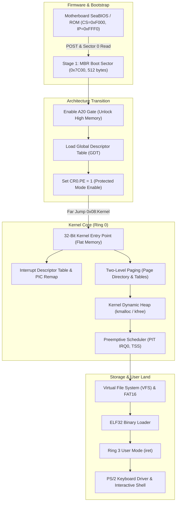

# SatnaOS: Deep Kernel Architecture & Systems Knowledge Base

> **A First-Principles Guide for Systems Programmers & C++ Engineers**  
> Document Version: 1.1 (Phase 2 Complete / Phase 3 Transition)

---

## Navigation & Topic Index
- [1. Systems Architecture & Execution Model](#1-systems-architecture--execution-model) *(Line ~20)*
- [2. Memory Topology: The First Megabyte](#2-memory-topology-the-first-megabyte) *(Line ~65)*
- [3. C++ Mental Models for Bare-Metal Systems](#3-c-mental-models-for-bare-metal-systems) *(Line ~110)*
- [4. Phase 1: Toolchain Architecture](#4-phase-1-toolchain-architecture) *(Line ~160)*
- [5. Phase 2: Bare-Metal Real-Mode Bootloader (16-Bit)](#5-phase-2-bare-metal-real-mode-bootloader-16-bit) *(Line ~205)*
  - [The Boot Sequence: From Reset Vector to 0x7C00](#the-boot-sequence-from-reset-vector-to-0x7c00)
  - [Dissection of `SatnaOS/boot.asm`](#dissection-of-satnaosbootasm)
  - [Opcode Hex Dump & Instruction Decoding Table](#opcode-hex-dump--instruction-decoding-table)
- [6. Phase 3 Blueprint: Multi-Sector Disk Loading via BIOS INT 0x13](#6-phase-3-blueprint-multi-sector-disk-loading-via-bios-int-0x13) *(Line ~310)*
- [7. Phase 4 Blueprint: 32-Bit Protected Mode Transition](#7-phase-4-blueprint-32-bit-protected-mode-transition) *(Line ~360)*

---

## 1. Systems Architecture & Execution Model

SatnaOS is a modular 32-bit x86 kernel. Developing an OS from scratch requires understanding that modern CPUs do not start in high-level 64-bit or 32-bit protected states. Instead, Intel processors power on in **16-bit Real Address Mode** to maintain 100% backward compatibility with the original 1978 Intel 8086 processor.



---

## 2. Memory Topology: The First Megabyte

In 16-bit Real Mode, the CPU possesses a 20-bit address bus, capable of accessing exactly **$2^{20} = 1,048,576\text{ bytes } (1\text{ MB})$** of physical RAM.

Memory addresses are represented as **`Segment:Offset`**:
$$\text{Physical Address} = (\text{Segment} \times 16) + \text{Offset} = (\text{Segment} \ll 4) + \text{Offset}$$

### Real Mode Physical Memory Map

| Physical Address Range | Size | Allocation / Description |
| :--- | :--- | :--- |
| `0x00000 - 0x003FF` | 1,024 B | **Interrupt Vector Table (IVT):** 256 4-byte entries (segment:offset far pointers) for BIOS and hardware interrupts. |
| `0x00400 - 0x004FF` | 256 B | **BIOS Data Area (BDA):** Hardware states, serial/parallel ports, timer tick counts. |
| `0x00500 - 0x07BFF` | ~30 KB | **Conventional Free Memory:** Usable RAM for bootloader scratchpad and stacks. |
| **`0x07C00 - 0x07DFF`** | **512 B** | **Boot Sector (MBR):** Target memory where BIOS loads our `boot.bin`. |
| `0x07E00 - 0x7FFFF` | ~480 KB | **Conventional Free Memory:** Primary staging area where we will load our subsequent kernel sectors from disk. |
| `0x80000 - 0x9FFFF` | 128 KB | **Extended BIOS Data Area (EBDA)**. |
| `0xA0000 - 0xBFFFF` | 128 KB | **Video Display Memory:** `0xB8000` is the memory-mapped I/O buffer for VGA text mode (80 columns $\times$ 25 rows). |
| `0xC0000 - 0xFFFFF` | 256 KB | **Motherboard ROM & BIOS Firmware**. |

---

## 3. C++ Mental Models for Bare-Metal Systems

As an intermediate C++ developer, many concepts in systems programming directly mirror abstractions you already use:

| C++ Paradigm | Low-Level Systems Equivalent | Conceptual Explanation |
| :--- | :--- | :--- |
| `reinterpret_cast<uint8_t*>(addr)` | **Direct Memory Pointer** | In OS dev, physical memory is a contiguous byte array. Pointing to `0xB8000` is literally creating a raw pointer to video display hardware. |
| `std::vector` / `new` / `delete` | **Kernel Dynamic Heap** | In userspace C++, the runtime requests memory from the OS via `brk`/`mmap`. In kernel space, **you are the OS**—you must write the allocator (`kmalloc`/`kfree`) from raw page blocks. |
| `virtual` Method Tables (`vptr`/`vtbl`) | **Interrupt Vector Table (IVT / IDT)** | A vtable is an array of function pointers indexed by method ID. The CPU's IDT is an array of interrupt handlers indexed by interrupt number (`0x10`, `0x80`). |
| Exception Handling (`try` / `catch`) | **CPU Traps & Faults** | A division by zero doesn't throw `std::runtime_error`; it triggers CPU interrupt `0x00` (Divide Error). If unhandled, it triggers a Triple Fault and reboots. |
| Thread Context / Call Stack | **Saved Registers & ESP** | A thread switch is simply pausing one instruction stream, saving registers (`EAX`, `EBX`, `ESP`) into memory (PCB), loading another thread's saved registers, and returning. |
| `no-stdlib` / Freestanding | **Zero Runtime Overhead** | We compile with `-ffreestanding -fno-builtin -nostdlib`. There is no `<iostream>`, `<memory>`, or `<string>`. Every utility must be constructed from first principles. |

---

## 4. Phase 1: Toolchain Architecture

### The Freestanding Compilation Pipeline
1. **NASM (Netwide Assembler):**
   - Assembles assembly files into flat binaries (`-f bin`) for MBR code, or 32-bit ELF object files (`-f elf32`) for protected mode.
2. **QEMU System Emulator:**
   - Provides a sandboxed virtual PC with SeaBIOS, virtual 8259 interrupt controllers, IDE hard disk emulation, and serial/VGA display.
   - Command syntax: `qemu-system-i386 -drive format=raw,file=boot.bin` explicitly treats `boot.bin` as a raw sector disk.
3. **Dedicated Cross-Compiler (`i686-elf-gcc`):**
   - Essential for compiling kernel C files without host OS library leakage. Targets pure 32-bit ELF specifications.

---

## 5. Phase 2: Bare-Metal Real-Mode Bootloader (16-Bit)

### The Boot Sequence: From Reset Vector to 0x7C00
1. **CPU Reset:** Upon power delivery, the CPU registers are set to known states:
   $$\text{CS} = 0xF000, \quad \text{IP} = 0xFFF0 \implies \text{Physical Address} = 0xFFFF0$$
2. **BIOS POST:** The motherboard ROM checks system memory and enumerates bootable media.
3. **MBR Loading:** BIOS reads the first 512-byte sector (Cylinder 0, Head 0, Sector 1) of the boot disk into RAM at physical address **`0x0000:0x7C00`**.
4. **Signature Check:** BIOS validates that bytes 510–511 equal `0x55` and `0xAA`.
5. **Execution Hand-off:** BIOS performs a far jump to `0x0000:0x7C00`.

---

### Dissection of `SatnaOS/boot.asm`

Below is the verified implementation in [`SatnaOS/boot.asm`](file:///home/praveen/Documents/vs/kernel/SatnaOS/boot.asm):

```nasm
ORG 0               ; Set origin to 0 within active segment 0x07C0
BITS 16             ; 16-bit real-mode machine instructions

jmp 0x7c0:start     ; Far jump standardizes CS to 0x07C0 and flushes pipeline

start:
    cli             ; 1. Disable maskable interrupts during stack initialization
    mov ax, 0x07c0  ; Set Data Segment (DS) & Extra Segment (ES) to match CS
    mov ds, ax
    mov es, ax
    mov ax, 0x00 
    mov ss, ax      ; Set Stack Segment (SS) = 0x0000
    mov sp, 0x7c00  ; Set Stack Pointer (SP) = 0x7C00 (grows downward safely)
    sti             ; Re-enable interrupts once stack is sound

    ; Print greeting string
    mov si, message
    call print
    jmp $

print:
    mov bx, 0       ; BH=0 (display page 0)
.loop:
    lodsb           ; AL = [DS:SI], SI++
    cmp al, 0       ; Check for null-terminator
    je .done
    call print_char ; Render character on screen
    jmp .loop
.done:
    ret

print_char:
    mov ah, 0eh     ; BIOS teletype output function code
    int 0x10        ; Video services software interrupt
    ret    

message db 'Hello, World!', 0

times 510 - ($ - $$) db 0   ; Pad remaining bytes to 510
dw 0xaa55                   ; 2-byte MBR boot signature (0x55, 0xAA)
```

---

### Opcode Hex Dump & Instruction Decoding Table

Analyzing the compiled binary ([`SatnaOS/boot.bin`](file:///home/praveen/Documents/vs/kernel/SatnaOS/boot.bin)) byte-for-byte reveals how CPU instructions are encoded:

```
00000000  ea 05 00 c0 07 fa b8 c0  07 8e d8 8e c0 b8 00 00  |................|
00000010  8e d0 bc 00 7c fb be 31  00 e8 02 00 eb fe bb 00  |....|..1........|
00000020  00 ac 3c 00 74 05 e8 03  00 eb f6 c3 b4 0e cd 10  |..<.t...........|
00000030  c3 48 65 6c 6c 6f 2c 20  57 6f 72 6c 64 21 00 00  |.Hello, World!..|
*
000001f0  00 00 00 00 00 00 00 00  00 00 00 00 00 00 55 aa  |..............U.|
```

| Byte Offset | Hex Encoding | NASM Instruction | Hardware Operation |
| :---: | :--- | :--- | :--- |
| `0x0000` | `EA 05 00 C0 07` | `jmp 0x07C0:start` | Opcode `EA` is far inter-segment jump (`jmp ptr16:16`). Forces `CS = 0x07C0` and jumps to offset `0x0005`. |
| `0x0005` | `FA` | `cli` | Clears Interrupt Flag (IF), disabling maskable external interrupts. |
| `0x0006` | `B8 C0 07` | `mov ax, 0x07C0` | Loads immediate `0x07C0` into `AX`. |
| `0x0009` | `8E D8` | `mov ds, ax` | Initializes Data Segment register `DS = 0x07C0`. |
| `0x000B` | `8E C0` | `mov es, ax` | Initializes Extra Segment register `ES = 0x07C0`. |
| `0x000D` | `B8 00 00` | `mov ax, 0x0000` | Zeroes `AX`. |
| `0x0010` | `8E D0` | `mov ss, ax` | Initializes Stack Segment `SS = 0x0000`. |
| `0x0012` | `BC 00 7C` | `mov sp, 0x7C00` | Sets Stack Pointer `SP = 0x7C00` (growing downward into free RAM). |
| `0x0015` | `FB` | `sti` | Sets Interrupt Flag (IF), re-enabling maskable hardware interrupts. |
| `0x0016` | `BE 31 00` | `mov si, 0x0031` | Loads `SI` with offset `0x0031` relative to `DS` (pointing to `message`). |
| `0x0019` | `E8 02 00` | `call print` | Relative near call jumping +2 bytes ahead over `jmp $`. |
| `0x001C` | `EB FE` | `jmp $` | Short relative jump (`0xFE` = -2), infinite halt loop. |
| `0x001E` | `BB 00 00` | `mov bx, 0x0000` | Opcode `BB` loads immediate `0x0000` into `BX`. |
| `0x0021` | `AC` | `lodsb` | Loads byte at `[DS:SI]` into `AL`, auto-increments `SI`. |
| `0x0022` | `3C 00` | `cmp al, 0` | Compares `AL` with zero, updating Zero Flag (`ZF`). |
| `0x0024` | `74 05` | `je .done` | Jump if Equal (`ZF == 1`). Jumps +5 bytes to `ret`. |
| `0x0026` | `E8 03 00` | `call print_char` | Relative call jumping +3 bytes to `print_char`. |
| `0x0029` | `EB F6` | `jmp .loop` | Short jump backward (`0xF6` = -10), looping back to `lodsb`. |
| `0x002B` | `C3` | `ret` | Returns from `print` routine. |
| `0x002C` | `B4 0E` | `mov ah, 0x0E` | Loads BIOS Teletype function code `0x0E` into `AH`. |
| `0x002E` | `CD 10` | `int 0x10` | Triggers software interrupt `0x10` (BIOS Video Service). |
| `0x0030` | `C3` | `ret` | Returns from `print_char`. |
| `0x0031` | `48 65 6C... 00` | `'Hello, World!', 0` | Raw ASCII string bytes ending with null byte `0x00`. |
| `0x01FE` | `55 AA` | `dw 0xAA55` | Valid MBR boot signature bytes in little-endian order. |

---

## 6. Phase 3: The Interrupt Vector Table (IVT), Disk Reading & Early Filesystem Architecture

With the 512-byte boot sector established, our kernel must overcome the fundamental physical limit of the MBR: an entire operating system kernel cannot fit in 512 bytes. Phase 3 implements the **secondary loader stage**: reading subsequent sectors from disk into RAM using the BIOS Interrupt Vector Table.

---

### The Interrupt Vector Table (IVT): The CPU's Master Dispatcher

The **Interrupt Vector Table (IVT)** is located at the very lowest memory address in physical RAM: **`0x00000` to `0x003FF`** (exactly 1,024 bytes).

- **Structure:** Exactly 256 entries. Each entry is a **4-byte far pointer (`Segment:Offset`)** pointing to an interrupt service routine (ISR) residing in BIOS ROM or system RAM.
- **Entry Size:** $256 \times 4\text{ bytes} = 1,024\text{ bytes } (0x400)$.

```
IVT Memory Map (Physical 0x00000 - 0x003FF):
+-----------------------------------------------------------+
| Vector 0x00: Divide Error Handler Far Pointer (4 bytes)   |
| Vector 0x01: Single Step / Debug Handler (4 bytes)        |
| ...                                                       |
| Vector 0x10: BIOS Video Services (0x0000:0x0040)          |
| ...                                                       |
| Vector 0x13: BIOS Low-Level Disk Services (0x0000:0x004C) |
| ...                                                       |
| Vector 0xFF: Highest Vector Entry                         |
+-----------------------------------------------------------+
```

#### Real-World Analogy: The Skyscraper Emergency Switchboard
Imagine a massive corporate tower with 256 dedicated emergency hotlines. When you dial `13`, the lobby switchboard looks up line 13's room number (`Segment:Offset`) and instantly patches your call through to the freight elevator mechanics (the disk controller). You don't need to know where the mechanics' room is in the building; the switchboard at the front desk handles the dispatch.

#### C++ Mental Model: A Global Hardware Virtual Method Table (`vtbl`)
In C++, dynamic polymorphism uses a vtable—an array of function pointers. The CPU's IVT is literally a hardware vtable built into memory at address 0:

```cpp
struct FarPointer {
    uint16_t offset;
    uint16_t segment;
};

// Physical Address 0x00000 contains this exact array:
FarPointer IVT[256];

// When assembly executes: int 0x13
// The CPU internally does:
FarPointer target = IVT[0x13];
push(FLAGS);
push(CS);
push(IP);
CS = target.segment;
IP = target.offset;
```

---

### Reading from Disk via BIOS `INT 0x13` (Function `AH = 0x02`)

The CPU cannot address disk bytes like RAM; disks are **block devices** organized into sectors.

#### Cylinder-Head-Sector (CHS) Geometry
In Real Mode, disks are addressed using **CHS**:
- **Cylinder (`CH`):** Concentric circular tracks on the spinning platter (like rings on a tree trunk).
- **Head (`DH`):** Which magnetic read/write head (platter surface: top or bottom).
- **Sector (`CL`):** A 512-byte arc segment of a track. **Critical Rule: Sector numbers are 1-based, not 0-based!**
  - Sector 1 = The MBR boot sector.
  - Sector 2 = Our custom payload (`message.txt` / kernel code).

#### The Carry Flag (`CF`) as the Hardware Return Value
In C++, a function returns a `bool` or throws `std::runtime_error` on failure. In x86 assembly, the BIOS signals status through the CPU's **Carry Flag (`CF`)**:
- **`CF = 0` (Clear):** Operation succeeded. Data was read into memory buffer `[ES:BX]`.
- **`CF = 1` (Set):** Hardware failure! The `AH` register contains the hardware error status code (e.g. drive not ready, CRC error, bad sector).
- **`jc error` (Jump if Carry):** Branches immediately to an error handler if `CF == 1`.

---

### Early Filesystem Architecture: The BIOS Parameter Block (BPB)

In [`SatnaOS/boot.asm`](file:///home/praveen/Documents/vs/kernel/SatnaOS/boot.asm), notice lines 4–8:

```nasm
_start:
    jmp short start     ; 2-byte short jump past filesystem header
    nop                 ; 1-byte padding (total 3 bytes)

    times 33 db 0       ; 33 bytes reserved for FAT12/FAT16 BPB
```

#### Why is this necessary?
Real-world filesystems like FAT12, FAT16, and FAT32 store filesystem metadata directly in the boot sector (OEM name, bytes per sector, sectors per cluster, number of FAT copies, root directory count). This metadata table is called the **BIOS Parameter Block (BPB)**.

- Operating systems (DOS, Windows) and USB flashing tools inspect sector 0.
- They expect the first 3 bytes to be `EB xx 90` (`jmp short; nop`), followed immediately by the BPB.
- If you don't reserve this space with `times 33 db 0`, formatting utilities or aggressive motherboard BIOSes will overwrite your executable code with disk geometry parameters, crashing your system!

---

### Code Walkthrough & Disk Image Construction

#### 1. [`SatnaOS/boot.asm`](file:///home/praveen/Documents/vs/kernel/SatnaOS/boot.asm)
```nasm
    ; Read Sector 2 from Disk into Memory Buffer
    mov ah, 2           ; BIOS Read Function (AH=0x02)
    mov al, 1           ; Read exactly 1 sector (512 bytes)
    mov ch, 0           ; Cylinder 0
    mov cl, 2           ; Sector 2 (Sector 1 is MBR)
    mov dh, 0           ; Head 0
    mov bx, buffer      ; Offset of buffer in RAM
    int 0x13            ; Issue BIOS disk interrupt
    jc error            ; If Carry Flag is set, branch to error handler

    mov si, buffer      ; Point SI to loaded disk data
    call print          ; Display disk data on screen
    jmp $

buffer:                 ; Sits immediately after byte 512
```

Where does `buffer` sit in RAM?
- `buffer:` is declared at the end of the 512-byte sector (`dw 0xaa55`).
- In RAM, because `DS = ES = 0x07C0`, the memory location is `0x07C0:0x0200`.
- Physical address: $(0x07C0 \times 16) + 0x0200 = 0x7C00 + 512 = \mathbf{0x7E00}$.
- Sector 2 is copied into memory directly following the bootloader.

#### 2. [`SatnaOS/Makefile`](file:///home/praveen/Documents/vs/kernel/SatnaOS/Makefile)
The build system uses GNU `dd` (Data Duplicator) to stitch together a multi-sector raw disk image:

```makefile
all:
	nasm -f bin boot.asm -o boot.bin
	dd if=./message.txt >> ./boot.bin
	dd if=/dev/zero bs=512 count=1 >> ./boot.bin
```

1. `nasm -f bin boot.asm -o boot.bin`: Emits 512 bytes of Sector 1 ending in `0x55 0xAA`.
2. `dd if=./message.txt >> ./boot.bin`: Appends payload data into Sector 2.
3. `dd if=/dev/zero bs=512 count=1 >> ./boot.bin`: Pads with zeroes, ensuring Sector 2 is complete.

---

## 7. Phase 4 Blueprint: 32-Bit Protected Mode Transition

- **A20 Gate:** Enable the 21st address line to access beyond 1 MB without memory wrap-around.
- **Global Descriptor Table (GDT):** Construct code and data segment descriptors covering 4 GB flat memory.
- **Control Register 0 (`CR0`):** Set Bit 0 (Protection Enable, `PE`).
- **Far Jump:** Execute `jmp 0x08:kernel_start` to flush the CPU pipeline and switch into 32-bit execution.

